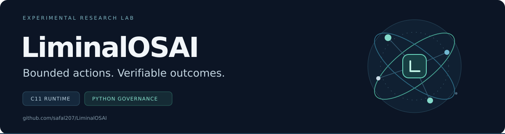

# LiminalOSAI

**An experimental lab for bounded AI-agent actions and reproducible evidence.**

Explore explicit authority, controlled execution, STOP and recovery, and receipts
that let another system check what happened. The repository combines Python
governance reference modules with a pulse-driven C11 research runtime.

**Experimental** · **C11 + Python** · **[MIT](LICENSE)**

[Quickstart](#quickstart) · [Documentation](docs/README.md) ·
[Verified draft experiment](docs/AGENT_CONTROL_REVIEW_INDEX.md) ·
[Roadmap](ROADMAP.md) · [Contribute](#contribute)

## Choose a path

| Your goal | Start here | Availability |
| --- | --- | --- |
| Build and inspect the C11 runtime | [Runtime guide](docs/C11_RUNTIME_GUIDE.md) | In this checkout |
| Explore action plans, approvals and signed evidence | [Governance documentation](docs/README.md#python-governance-and-evidence) | Reference modules in this checkout |
| Integrate a deterministic workload receipt | [TRCP Adapter SDK](docs/TRCP_ADAPTER_SDK.md) | In this checkout |
| Review the owned-agent STOP experiments | [Review and reproduction index](docs/AGENT_CONTROL_REVIEW_INDEX.md) | Separate verified draft stack |
| Explore the original research concepts | [Conceptual layer map](docs/LIMINAL_LAYER_MAP.md) | Research vocabulary, separately documented |

## What the project explores

- **Bounded authority:** explicit scopes, immutable plans and separate execution authorization.
- **Evidence:** trace records, canonical workload binding and signed receipts in defined profiles.
- **Recovery:** uncertainty remains visible when responses, observations or settlement are missing.
- **Runtime research:** small C11 subsystems, diagnostic traces and repeatable local experiments.

The [scope note](docs/EXPERIMENTAL_SCOPE.md) identifies the implemented surfaces
and their trust assumptions. This is experimental reference software. Production
readiness, general sandbox-escape resistance and AGI are not established.

## Quickstart

### Build the C11 runtime

Requires a C compiler, Make and Python 3. From the repository root:

```bash
make
make check
./build/pulse_kernel --dry-run --limit=2
```

`make check` also runs the substrate binary. See the [runtime guide](docs/C11_RUNTIME_GUIDE.md)
for options, diagnostics and both binaries.

### Try a local evidence adapter

This synthetic order-reservation example uses Python 3, without a model key or
external service credentials:

```bash
python3 -m examples.trcp_external_consumer_reference.self_check
python3 -m examples.trcp_external_consumer_reference.self_check --execution-replay
```

Binding verification and execution replay are reported separately. The first
command reports execution replay as `NOT_RUN`; the second invokes the example's
consumer-owned replay hook. [Integration guide](docs/TRCP_ADAPTER_SDK.md).

### Run the baseline checks

```bash
make test
make test-repo
```

Additional governance and broker profiles have their own checks in the
[documentation index](docs/README.md). Test results apply to the checks executed.

## A verified draft, with a defined scope

The owned-agent work is proposed in [draft PR #218](https://github.com/safal207/LiminalOSAI/pull/218).
It is separate from the default-branch reference modules above. Its evidence is
bound to source [`7cccc020`](https://github.com/safal207/LiminalOSAI/commit/7cccc020ed190af04380c600b5eaa8c289f91e7b).

| Recorded evidence at that revision | Result |
| --- | --- |
| CI checks | 15 successful checks |
| Isolated-agent CI | 245 profile tests + 5 runtime tests; no skips |
| Real Docker matrix | 12 fixed scenarios; 6 owned synthetic endpoint effects |
| Downloaded-capture verifier replay | 36 tests passed; no skips |

The fixture uses a fixed policy and makes **zero model API calls**. Host, daemon,
image, clocks and stores remain trusted. Host observations are unsigned
diagnostics; an admitted request can finish after STOP. A receiver-side final
commit fence is a planned next step.

[Inspect the evidence, limitations and reproduction commands →](docs/AGENT_CONTROL_REVIEW_INDEX.md)

## Contribute

Useful contributions include reproducing one pinned experiment, challenging a
specific evidence claim, testing a bounded failure case, and documenting an
integration contract.

- [Pick a review or reproduction task](docs/AGENT_CONTROL_REVIEW_INDEX.md#review-and-reproduce).
- [Open an issue](https://github.com/safal207/LiminalOSAI/issues/new) with the exact revision,
  commands, environment, observed result and expected result.
- Keep implementation changes and new claims scoped to one reviewable boundary.

## Further reading

| Area | Guide |
| --- | --- |
| Project scope and trust boundaries | [Experimental scope](docs/EXPERIMENTAL_SCOPE.md) |
| Plans, approvals and governance contracts | [Documentation index](docs/README.md) |
| Deterministic evidence benchmark | [TRCP benchmark](docs/benchmark-v0.1.md) |
| Longer-term direction | [Roadmap](ROADMAP.md) |
| Original conceptual research | [L0–L30 map](docs/LIMINAL_LAYER_MAP.md) · [Layer index](docs/layers-overview.md) |

## License

[MIT](LICENSE). Contributions remain subject to the repository's experimental scope.
