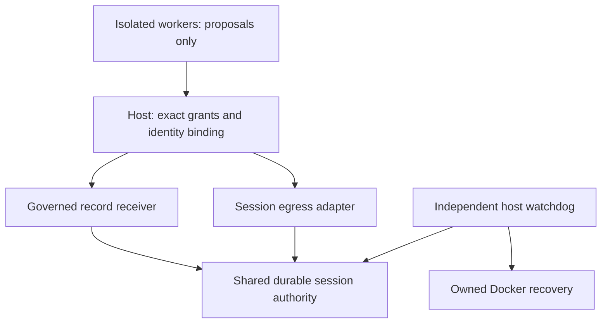

# Durable session brakes for agent actions

This extension binds the governed record receiver and the staged egress adapter
to one host-owned SQLite authority domain. Each new action needs an exact host
grant, a registered execution, a matching policy and epoch, a live controller
lease, and capacity in a shared budget. A model's approval, completion claim,
trace or memory cannot satisfy these requirements.

The [portfolio review](AGENT_CONTROL_PORTFOLIO_REVIEW.md) records the source
qualities selected from the repository collection. This is a bounded reference
implementation for trusted-host integration, not an automatically installed
security boundary for every existing SDK, connector or agent framework.

## Architecture and enforced scope



The authority database, administrative APIs, authentication keys, host clock and
Docker daemon stay outside worker control. A host must bind each worker's root
and execution identity before forwarding proposals; accepting an arbitrary
worker-supplied identity is not an authenticated transport. The existing
`WorkerBridge` pins record-action identities. The egress adapter is a host API;
this change does not add a network-capable worker protocol or expose it publicly.

| Mechanism | Enforced behavior |
|---|---|
| Immutable session | Root, controller identity, policy/objective digests, limits and hard deadline cannot be replaced through the session API. A digest binds a host-approved policy; it does not evaluate arbitrary natural-language goals. |
| Shared budget | All admitted records and egress actions consume the same root counter. DNS, secret lookup and transport callbacks also consume a shared stage budget. These are counts, not dollar, byte, token or CPU budgets. |
| Registered descendants | Count and depth are bounded; binding through the legacy authority API does not create a governed execution. |
| Controller lease | Receiver admission and each egress stage independently check freshness after acquiring the write lock. Renewal requires controller identity, epoch and a one-use lease revision. No worker heartbeat API exists. |
| Terminal stop | STOP, lease/hard-deadline expiry and detected clock rollback/error close the root and advance its epoch. Restart, reading status and repeated old renewals cannot reactivate it. |
| Atomic records | Grant, policy, session checks, budget reservation and record acceptance share a transaction. The receiver profile is durable; reopening without the gate fails. |
| Staged egress | Exact request and capability bindings persist; no callback executes under a SQLite transaction or long-held capability lock. Stage admission is the local boundary; already admitted callbacks can finish after STOP. |
| Recovery | RESERVED/UNKNOWN operations and their spent capacity survive restart. An uncertain network action is not automatically redispatched. A returned HTTP callback is not proof of remote commit. |
| Stop priority | The record broker persists its local fence before Docker inspection, freezing or remote revocation. Receiver acknowledgement and physical quiescence remain separate observations. |

The existing Docker profile supplies network isolation, read-only mounts,
non-root execution, dropped capabilities and CPU/RAM/PID constraints. These
controls become relevant when the trusted host actually launches and verifies
that profile. Importing the Python modules alone does not intercept sockets or
shell commands. Filesystem, provider billing and standalone credential adapters
remain separate until explicitly bound to the session gate.

## Run the integration example

From the checkout, with Python 3 and no additional dependencies or model key:

```bash
PYTHONDONTWRITEBYTECODE=1 PYTHONPATH=sdk python3 -m unittest \
  tests/test_agent_control_brakes_store.py \
  tests/test_agent_control_brakes_receiver.py \
  tests/test_agent_control_brakes_egress.py \
  tests/test_agent_control_brakes_watchdog.py -v

PYTHONDONTWRITEBYTECODE=1 PYTHONPATH=sdk python3 -m liminal_agent_control.brakes_demo \
  --output artifacts/brakes/report.json
```

The example executes two actual compositions. In `shared_budget`, an authorized
record and an owned transport callback consume a two-action budget; subsequent
records and network proposals are denied. In `shared_stop`, both useful actions
run, STOP closes the root while capacity remains, and both later paths are
blocked. Receiver inventory and the owned sink are read separately from action
return values. The transport is an in-memory fixture; no DNS or network socket
is opened. Source commit, tree, dirty state and Python input hashes are included.
The report itself is not an independent attestation.

The native tests additionally cover actual OS-process contention, subprocess
death, restart, stale renewals, clock failure, locked-database expiry, profile
downgrade, lost responses and a held transport callback. The Docker-enabled CI
job separately exercises physical process cleanup; local Docker skips are not
evidence that those checks ran. Existing multi-worker/CML experiments retain
their own formats and scope; they are not silently upgraded by this example.

## Host integration

The exact working assembly is in
[`brakes_demo.py`](../sdk/liminal_agent_control/brakes_demo.py). Its important
host calls are:

```python
authority = SessionAuthority("host-private/authority.sqlite")
state = authority.create_session(
    "campaign-1", controller_id="operator-1",
    policy_digest=policy_sha256, objective_digest=objective_sha256,
    max_actions=20, max_executions=4, max_depth=1, max_stages=60,
    lifetime_seconds=300, lease_seconds=10,
)
authority.bind_execution("campaign-1", "worker-1")
receiver = Receiver(authority.db_path, broker_key, receipt_key,
                    admission_controller=authority)
broker = Broker("host-private/broker.sqlite", receiver)
broker.authorize(exact_record_action, policy_version=policy_sha256)

# Administrative controller only; retain the returned revision for next renew.
state = authority.renew("campaign-1", controller_id="operator-1",
                        expected_epoch=state["epoch"],
                        expected_revision=state["lease_revision"])

# This closes BOTH governed records and governed egress admission.
closed = authority.stop("campaign-1")
```

Use private persistent directories and a single local filesystem providing
SQLite's required locking/durability semantics. Do not mount the database,
registry, keys or Docker socket into workers. The `controller_id` argument is
an identity binding inside the trusted host API, not a password or a substitute
for OS/service authentication. Database deletion, rollback or a hostile host
administrator are outside this trust boundary.

For egress, create `SessionEgressGateway(authority=authority, ...)` with the
host's resolver, transport and capability broker. Build `network_action` from
the exact `GatewayRequest`; host `authorize(..., capability_id=...)` freezes the
request/capability pair, then `execute(action, request)` consumes it. For this first adapter, a root is pinned to one capability-broker process
incarnation. The supported capability contracts are non-delegable; descendant workers are
registered through SessionAuthority, not capability-parent delegation.
Recreating or forking that broker cannot continue old-root egress;
a trusted controller must create a new session. This prevents in-memory
capability use limits or revocations from resetting while keeping an old root.

The host must ensure its transport honors the validated destination and IPs. A digest
of a body is not enforcement of the actual transmitted bytes; a real transport
must validate those bytes and add appropriate size limits.

The standalone receiver service supports `--governed` for opening an already
prepared governed authority database. Its shared broker authentication key
remains host-only. A fresh session must be provisioned by the host beforehand.

## Independent watchdog and stop interpretation

Launch the watchdog from a separate host service/supervisor, outside both the
worker container and the main controller's process group. Deployment of that
service is an explicit integration step; this repository does not install it.

```bash
PYTHONPATH=sdk python3 -m liminal_agent_control.brakes_watchdog \
  --authority-db host-private/authority.sqlite --root-id campaign-1 \
  --max-wait 300 --output host-private/watchdog-report.json
```

It never renews authority. Lease expiry or a terminal root closes admission.
`--max-wait` is a terminal watchdog deadline, not a silent exit while allowing
the session to continue. The output path must be new. To request recovery of
the matching owned Docker registration, additionally supply all four:

```text
--registry host-private/supervisor.sqlite
--broker-db host-private/broker.sqlite
--broker-key-file host-private/broker.key
--receipt-key-file host-private/receipt.key
```

Recovery verifies registry root and immutable container ownership before
termination. It cannot kill an arbitrary callback thread or retract a remote
request. Always inspect separate report fields:

- `admission_closed`: the shared local authority was observed terminal.
- `workload_verified`: matching owned Docker recovery observed zero survivors.
- Session pending action/stage counts and recovery observations: what remains
  unfinished or unknown. An egress callback marked RETURNED still lacks an
  independently established remote outcome.

A records operation accepted before STOP may complete afterward. An egress
stage admitted before STOP may likewise invoke or finish its callback later.
No new stage may be admitted after the shared fence. Receiver or store
unavailability, a callback timeout and an empty registry never establish full
quiescence. Recovery also requires the existing registry lease: if the controller remains
alive but hangs while holding that lease, recovery reports BUSY rather than
forcing ownership transfer. Admission still expires; physical cleanup is not
verified. A watchdog-owned launch/registry service is a further integration
step. If both controller and watchdog die, use-time lease checks still
close covered admissions, but physical cleanup needs a surviving supervisor.

## Next boundaries to complete

1. Make a production worker launcher require the controlled session and an
   independently supervised watchdog; enumerate every connector and inherited
   file descriptor. Prove mandatory mediation for each permitted effect path.
2. Add real provider cost/token and transmitted-byte reservations, plus governed
   filesystem/credential adapters. Preserve ambiguous cost after timeouts.
3. Add independently stored checkpoints to detect database rollback, a remote
   receiver fencing contract where possible, and external reproduction.
4. Only then use budgeted live-model trials to measure attempted violations,
   useful task completion and contradictory claims against receiver evidence.

**По-русски:** цель этого слоя — лишить агент возможности действовать без
свежего разрешения и общего бюджета в охваченных каналах. STOP закрывает новые
допуски; завершение старого действия и остановка процесса проверяются отдельно.
Это не доказательство отсутствия обмана в модели и не универсальная защита от
выхода из любой песочницы. Проверяемая граница важнее такого обещания.
