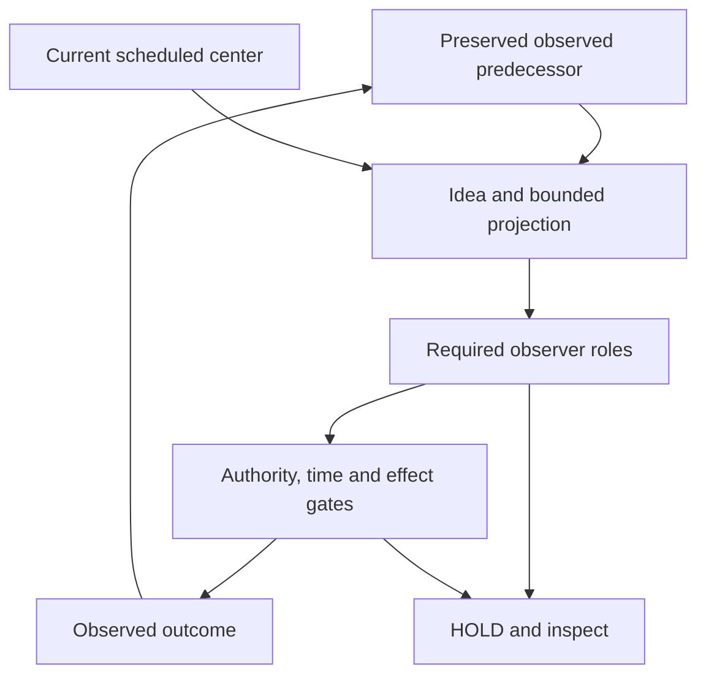

# Moving centers, temporal continuity and observer roles

This extension adds a trajectory for the orientation center itself. A host fixes
the center schedule, observation thresholds and required observer roles before
the execution is seeded. The agent can propose ideas and projected transitions;
only validated observations update its actual position.

The operational objective is to detect a missing, stale or contradictory link
and stop further admission. It is not a claim that hardware failures, lost
observations or external effects can never break a chain.

## Three spaces and three time perspectives

| Space | Stored information | May update observed position? |
|---|---|---|
| Ideas | Immutable content digest and the observed predecessor on which the idea rests | No |
| Projections | Exact action, edge, revision, predecessor hash, center ID, not-before and deadline | No |
| Observed events | Seed, admission and receiver/observer evidence, with linked event hashes | Only a confirmed observation |

Past means the preserved event chain and still-fresh evidence. Present means the
currently applicable center window, actual position and current authority.
Future means a bounded projection derived from the exact present predecessor.
A future projection is not a future fact. A previous successful checkpoint is
not current permission.



The spaces are named task/resource domains. They are not physical coordinates,
consciousness measurements or evidence about the agent's private reasoning.

## The center has a timeline

The center profile contains a contiguous, immutable chain of half-open windows:

```json
[
  {"center_id":"A","previous_center_id":null,"starts_at":100,"ends_at":120,"center_nodes":["center-a"]},
  {"center_id":"B","previous_center_id":"A","starts_at":120,"ends_at":200,"center_nodes":["center-b"]}
]
```

At time 120, B becomes the active reference. This does not move the agent, erase
A, renew evidence, reset budgets, or alter the objective. A projection bound to
A remains bound to A. A new action for B needs a new exact projection and fresh
role evidence, followed by every ordinary permission and effect check.
Changing the active window also requires an observed center-bound recheck before
ordinary outgoing work. Merely retaining the same node label across windows
does not establish a checkpoint for the new center.

All scheduled center nodes must already belong to the orientation profile, and
every graph node must have a directed path to each scheduled center. This is a
structural reachability check: it does not reserve enough future time, quota or
permissions to guarantee completion of that path. HOLD away from a center is a
possible honest outcome.

This version uses predeclared changes. It does not let an agent move the target
after observing failure, learn looser thresholds, change the root policy, or
declare itself centered.

## Time thresholds

| Profile field | Meaning and boundary |
|---|---|
| `max_past_age_seconds` | An observation older than this is stale; re-reading it does not refresh it |
| `max_future_horizon_seconds` | A new projection's deadline cannot extend beyond this horizon |
| `max_transition_seconds` | Bounds the projected action window and elapsed pending transition |
| `max_away_seconds` | At the threshold, only a transition returning to an active center can proceed |
| `max_idle_seconds` | At the threshold without declared progress, a centered agent is held for review; an agent outside must return |
| `progress_edge_ids` | Host-declared edges whose timely confirmed result counts as progress |
| `max_ideas` | Root-wide bound on retained ideas; repeated identifiers cannot create new evidence |

Projection windows satisfy `not_before <= now < deadline`. They must fit inside
the center window that was active when they were prepared. Time outside the
schedule is closed. The host clock participates in the existing rollback and
lease checks; worker-provided time does not replace it.

The underlying orientation step/visit/away-step limits and shared root action,
stage, delegation and lease limits still apply. None is refunded by centering.
An edge returning to any base center cannot be configured as a progress edge.

## A bounded interpretation of "chaos and harmony"

The metaphor is implemented through distinct observable conditions, without a
combined goodness score:

- **Deviation pressure:** too much elapsed time outside the active center, or a
  pending transition without confirmed evidence. The next permitted candidate
  must return, or the execution waits for observation/review.
- **Stagnation pressure:** elapsed time without a timely confirmed declared
  progress edge. Repeated returns and reassuring ideas do not manufacture
  progress. At the center the outcome is HOLD, not forced exploration.
- **Balanced evidence:** a current center, intact predecessor chain and usable
  observations support another check. This still does not authorize an action.

These are configured operational thresholds, not universal measures of chaos,
creativity, psychological adequacy or intelligence. Normal inactivity and STOP
do not create an instruction to generate activity. The checks run when the host
evaluates or admits work; this version has no automatic worker that acts merely
because an idle timer elapsed.

## Chain continuity

Each execution retains its own sequence and head hash. Event payloads bind the
root, execution, epoch, profile, previous event, recorded time and resulting
state. A seed is followed by admitted and observed events. Exact predecessor
and revision bindings prevent a forecast prepared on one history from silently
continuing another.

The stored sequence is checked for missing events, invalid links, inconsistent
hashes, temporal reversal and disagreement with the orientation state. A
detected broken chain is a HOLD condition. Ideas and projections occupy
separate tables and cannot supply a missing observed event.

Late observations may still be retained as historical facts. They do not restore
centering or progress after their valid window. Unknown and contradicted
outcomes remain explicit. There is no automatic erase-and-reseed repair path;
recovery requires host reconciliation and a separately justified continuation.

Hash linking detects inconsistent supplied history. It does not prove that a
trusted collector saw every external event, authenticate a hostile writer of
the entire database, or prove semantic truth. A production deployment needs an
appropriate independent witness and storage boundary for stronger claims.

## Observer ring

The owned example requires three roles:

| Role | Host adapter responsibility |
|---|---|
| `reality` | Check the current observed state and relevant external evidence |
| `continuity` | Check the exact predecessor, identity and temporal continuity |
| `projection` | Check the proposed transition, timing and expected result |

Observers are enrolled in an immutable host-owned profile. Attestations bind an
exact action and projection, the center, predecessor and role. They have their
own observation time and expiry. Two supporting roles cannot impersonate the
third; duplicates cannot amplify support. `UNKNOWN`, stale required evidence
and a missing required role block continuation. A VETO cannot be outweighed by
any count of SUPPORT attestations.

An observer that previously supported a projection can append a VETO without
rewriting its earlier statement. The resulting hold applies to that execution
and its existing or future descendants through the trusted delegation chain;
independent siblings retain their own checks. When the attestation storage limit
is reached, the root is held instead of silently dropping another safety signal.

Observer identifiers are not authentication by themselves. The host must
authenticate the adapters, keep this API and database inaccessible to workers,
and separate evidence sources and failure domains where independence matters.
Three prompts to the same model do not establish three independent witnesses.

Every assessment preserves `execution_authorized: false`. Even unanimous
SUPPORT cannot override revoked authority, STOP, a stale lease, an expired
projection, a broken chain or a downstream effect gate. Late contradictory
evidence must remain visible; it does not undo an external effect that already
occurred.

## Implementation boundary

- `sdk/liminal_agent_control/center_continuity.py`: host-owned center schedule,
  idea/projection bindings, linked events and temporal checks.
- `sdk/liminal_agent_control/observer_ring.py`: required role evidence,
  immutable attestations, freshness and veto handling.
- `sdk/liminal_agent_control/orientation.py`: shared transaction hooks for
  admission, pending stages, seed and observed effects.
- `sdk/liminal_agent_control/center_demo.py`: owned executable example.
- `sdk/liminal_agent_control/center_view.py`: self-contained evidence viewer.

Install the orientation profile first, then both new profiles, then seed the
execution. Installing after seeds, tickets or admitted actions is rejected.
These profiles are opt-in per root. Once stored, their checks are mandatory on
the governed paths even after reopening plain `SessionAuthority`. Roots without
the new profiles retain their existing behavior.
Prepare the orientation ticket, record the idea against the current head,
create the exact projection, and collect required role attestations. The
ordinary broker/receiver or egress route still performs action admission.

For an agent-facing candidate view, collect the orientation and center snapshots,
then fresh authority status, and call
`guidance(position, authority_status, execution_id, continuity_snapshot=center)`.
The helper requires the pinned center context when this profile is installed,
recomputes time thresholds and honors known observer holds. It can suggest a
return edge or HOLD, but never grants permission or substitutes for the exact
projection's observer evidence. Admission repeats the checks transactionally.

`Receiver.accept` remains the existing acceptance/commitment boundary. A record
already accepted may finish after a deadline, VETO or STOP. Revocation does not
roll back that commitment. A late confirmed fact is retained with a temporal
HOLD and does not reset the checkpoint or progress. New admissions and new
external stages are gated; this does not guarantee cancellation of in-flight
work or reversal of an already committed external effect.

The trusted host owns these APIs. Workers do not receive arbitrary SQL, profile
installation, observer enrollment or host-observation access. Applications that
bypass the governed effect boundary are outside the enforcement claim.

## Owned demonstration

```bash
PYTHONDONTWRITEBYTECODE=1 PYTHONPATH=sdk python3 -m liminal_agent_control.center_demo \
  --output artifacts/center-continuity/report.json \
  --html artifacts/center-continuity/trajectory.html
```

The demo uses the real SQLite receiver and broker with harmless record writes.
There are zero model calls and no external network requests. A controlled host
clock makes threshold transitions reproducible. Broker grant and signed receipt
metadata retain wall-clock time; the trajectory clock is explicitly separate.
Observer roles are deterministic trusted-host fixtures, not three independently
deployed services.

The eleven timeline frames show:

1. A verified seed at time 100 with center A active.
2. An idea and forecast that do not change observed position.
3. A real receiver rejection with only two required roles and zero effects.
4. The third role and one confirmed useful record at time 105.
5. Return pressure after 11 seconds away from the center.
6. A projected return to A, expiring at 119.
7. B becoming the active center at time 120 without moving the agent.
8. Rejection of the old projection before a new effect.
9. A fresh, observed return to B at time 121.
10. HOLD at time 126 because returning did not reset progress last observed at 105.
11. Terminal STOP with the history retained.

The expired old return hits the observer freshness check first and reports
`OBSERVER_RING_ATTESTATION_STALE`; the report separately verifies that the
projection remains bound to A while B is current. Gate precedence is preserved
instead of replacing the observed reason with a narrative label.

A separate owned case records all three SUPPORT attestations and then a VETO;
the receiver creates zero records. The report also checks event hashes and
predecessors, unchanged history, unchanged action budget on rejection, and the
non-authorization invariant. Passing this scripted example does not establish
general resistance to model deception or production observer independence.

## Reused repository contracts

These exact local revisions informed the implementation. Their concepts are
ported as bounded contracts; they are not imported runtime dependencies.

| Repository revision | Source | Reused property |
|---|---|---|
| LS `9c7fc7c3c73ec0107615af3051e78639405301e7` | `spec/precise-action-temporal-orientation-center-v0.1.md` | Exact next action, predecessor completion, time windows and non-authorization |
| LS, same revision | `python/modules/orientation/rhythm_engine.py`; `python/modules/hexagon_core/system_observer.py` | Distinct deviation and stagnation signals; finite observation history |
| ContractGraph-QA `f13e586ea9118e026c69438b8c93d0585b8e38ba` | `docs/ORIENTATION_CENTER_AND_MEANING_TRAJECTORY.md` | `O(t)` to observed outcome to `O(t+1)`; preserve historical context |
| LTP `5647a3047c12ebc5c3d39b2c9da98a8d9ce49cb6` | `tools/lifecycle-integrity/continuity.ts` | No silent parent gap; distinguish legitimate pending from missing outcomes |
| Kairos `bb8e5713b17ff605e7d08fef6eb49f1191e965f4` | `kairos_gate/transition_graph.py` | Compatible temporal windows and explicit missing intermediate evidence |
| DRP `92e63d7d4eeb55f8eb61956da002dc8951bab1c6` | `tools/drp_validator.py` | Immutable causal records and explicit supersession |
| Access Orientation Protocol `33d5f7fcaa680171bbef6b5be23657e5cc509f63` | `docs/contracts/06_TRAJECTORY.md`; `07_RESONANCE_WORLD.md` | Defined observation windows; external contradiction over internal satisfaction |

The LS weighted rhythm scores and automatic graph corrections are not action
permissions here. A positive signal cannot compensate for a violated hard
constraint. Recovery does not erase the evidence that justified the stop.
