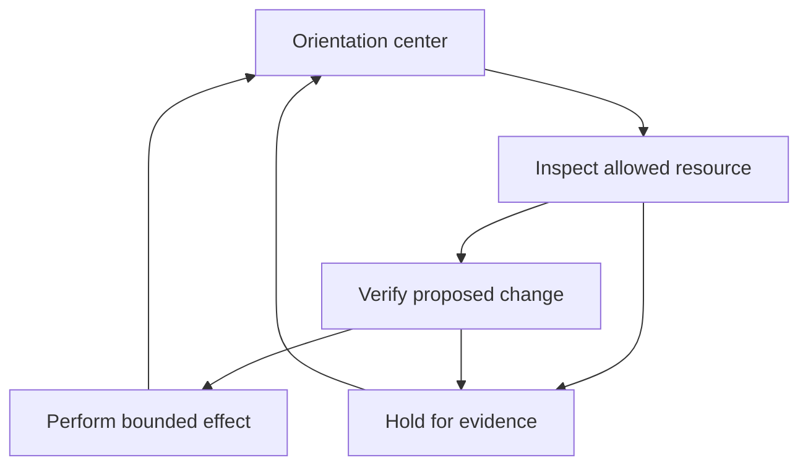

# Spatial and temporal orientation for governed agents

This extension adds a transition graph to the
[durable session brakes](AGENT_CONTROL_BRAKES.md). It asks where an execution is,
which transition it proposes, and which observed facts justify continuing.
The purpose is to keep task progress connected to the operator's boundaries,
current evidence and the trajectories of other participants.

The **orientation center** is a host-defined reference state with explicit
constraints. It is not a model's feeling of confidence, a consciousness claim,
or a score that grants permission. An agent may propose a useful next step;
the host still checks every applicable control before admitting its effect.

## Coordinates and the center

Spatial coordinates describe task and resource domains: a workspace, a review
stage, a receiver, or an allowed destination. They are not physical distances,
geographic coordinates, or measurements of an agent's internal mental state.
Temporal coordinates describe ordered transitions, fresh observations and
bounded validity. They must come from trusted host records, not worker prose.

| Coordinate | Operational meaning |
| --- | --- |
| Identity | Root, epoch and execution identify one governed participant. |
| Space | A declared state belongs to a bounded task/resource domain. |
| Time | Observation age, transition order and session deadlines constrain continuation. |
| Intent | The graph remains bound to the session's immutable objective and policy. |
| Evidence | A proposed or admitted transition differs from a confirmed position. |
| Center | A declared reference state permits bounded departure and explicit return. |

The center is not an additional goal to maximize at any cost. It provides a
place to check orientation while the agent pursues the actual task. A return
may restore the graph's bounded departure counter; it never refunds action or
stage capacity, extends a lease, changes authority, or clears a terminal STOP.

Every hard condition must pass independently. A high task score cannot offset
the wrong actor, stale evidence, a forbidden domain, a missing predecessor,
an exhausted budget, or revoked authority. There is no weighted average of
these failures that becomes permission.

## Graph topology and actual history

This small topology illustrates a bounded departure, an evidence-dependent
continuation, and a return to orientation. The labels are illustrative; the
host defines the concrete states and permitted edges.



A drawn edge is not an authorization. Its use still requires an exact host
grant, live session authority and a valid graph transition. The topology may
contain correction loops. Actual history records distinct occurrences with
increasing position revisions and predecessor references, so returning to the
same named state does not erase the previous visit or create a causal cycle.

An observed trajectory is therefore more than an ordered list of proposed
actions. It preserves the difference between intended movement, admitted work,
confirmed effects and unresolved outcomes. A single successful snapshot cannot
establish that a long trajectory remains stable.

## Runtime boundary

`OrientationStore` attaches a durable graph profile to the same SQLite
authority domain used by `SessionAuthority`. The host configures the profile
before actions begin. It is immutable for that session; an agent cannot redraw
its boundaries after encountering a denial. A new approved profile requires a
new session rather than reactivating an old root.

The graph check is an additional **deny-only** condition inside session
admission, not an alternative authorization path. It uses the existing write
transaction to compare the current execution position, validate the transition
and reserve it together with the shared action capacity. The host's fresh
clock is read after acquiring the lock. An earlier assessment is not a permit
that remains valid while the request waits.

The state distinction is mandatory:

| Event | Position consequence |
| --- | --- |
| Worker proposes a transition | No observed position change. |
| Host binds an exact action to a transition | No observed position change or execution permission. |
| Gate admits the action | A pending transition is reserved; it is not yet a confirmed destination. |
| Record receiver commits its actual effect | The corresponding observed position advances in the same transaction. |
| Callback returns without authoritative effect evidence | Return alone does not confirm the destination. |
| Outcome is uncertain | Pending state holds dependent continuation across restart. |
| Session stops or expires | No new admission; earlier admitted work may still complete. |

The record receiver can confirm its own durable effect directly. An external
service requires a trusted observation path appropriate to that service; a
worker-written receipt, an HTTP callback returning, or a model's success claim
cannot substitute for it. The graph does not make an external effect atomic
with the local database.

Bounds on visits and steps away from the center make repeated detours explicit.
They complement the root's shared action, stage and descendant budgets. Useful
progress does not silently increase any of those limits. Reopening the process
does not discard pending transitions, earlier visits or spent capacity.

## Separate participants, explicit cooperation

Each execution retains its own position and trajectory. Shared objectives do
not merge identities, observations, authority or effect ownership. A peer's
message cannot become the receiver's observation, and a sibling cannot use an
action bound to another execution.

A common center means common constraints and an inspectable reference frame;
it does not mean that all agents become one indistinguishable actor. Explicit
delegation and evidence-backed handoffs require their own host checks. This
extension does not infer those permissions from agreement between agents.

## Run and inspect an actual trajectory

```bash
PYTHONDONTWRITEBYTECODE=1 PYTHONPATH=sdk python3 -m unittest \
  tests/test_agent_control_orientation_store.py \
  tests/test_agent_control_orientation_gate.py \
  tests/test_agent_control_orientation_demo.py -v

PYTHONDONTWRITEBYTECODE=1 PYTHONPATH=sdk python3 -m liminal_agent_control.orientation_demo \
  --output artifacts/orientation/report.json \
  --html artifacts/orientation/trajectory.html
```

Open `trajectory.html` locally. The timeline shows two independent executions:
a committed record, a blocked extra excursion, a network action awaiting
observation, an ineffective worker success claim, and verified returns to
checkpoints. The final frame preserves STOP even though both observed positions
are in the center. The viewer has no control or authorization endpoint.

The example uses an owned SQLite receiver and an in-memory transport/sink. It
does not call a model or the internet. It exports the checked-out source commit,
tree, dirty flag and actual Python source digests. CI runs the example and
checks timeline interaction and mobile rendering in Chromium; read that run's
status rather than treating this guide as a test certificate.

The host integration order is:

1. Create a session and bind its executions through `SessionAuthority`.
2. Create the governed receiver, then install an immutable `OrientationStore`
   profile before any action has been admitted. Freeze nodes, directed edges,
   center nodes, observer identities and limits.
3. Seed each execution from a fresh host observation. A new execution ID or a
   child binding alone cannot establish its initial position.
4. `prepare(action, edge_id=..., expected_revision=...)` binds an exact proposed
   transition. The ordinary exact-action broker grant is still required.
5. Records confirm in the receiver's transaction. External effects require a
   trusted observer to verify the receiver evidence and then call `observe`
   with exact action/root/execution/epoch/profile bindings, observation time,
   outcome and evidence digest. `observer_id` pins that host adapter; it is not
   cryptographic authentication by itself. Workers cannot call this interface.
6. Inspect `snapshot(root_id)` for immutable seed evidence, tickets, occurrences,
   observations and each execution's current position/pending transition.

The working profile and assembly are in
[`orientation_demo.py`](../sdk/liminal_agent_control/orientation_demo.py).
Graph enforcement is persisted and checked inside the existing action/stage
transactions; reopening plain `SessionAuthority` does not remove it.

`orientation_guidance.guidance(snapshot, authority_status, execution_id)` gives
the selected actor a read-only view: `TRANSITION_CANDIDATE`, `RETURN_CANDIDATE`
or `HOLD`, with eligible structural edges and a reason. It prefers a bounded
return to a checkpoint when outside the center. Missing observations, stale
evidence or stopped authority yield HOLD. The result always says
`execution_authorized: false` and `downstream_gates_required: true`.
Supply this through a host-bound read tool if an agent should plan against its
orientation context. A cached recommendation is not authority; the receiving
gate rechecks the actual action, current session and trajectory.

Step and visit counters conservatively count admitted transitions, including
uncertain attempts. Observed node/revision advances only on confirmation.
A pending or unknown return to a center does **not** reset the excursion
counter. A confirmed return resets only that counter, never cumulative visits,
shared budgets, leases or STOP.

Every node must have a structural path back to a center. That does not establish
that remaining authority, time or resource budgets can fund that path. Budget
exhaustion still holds the execution, even away from the center. Stale evidence
and contradiction do not automatically recover: a trusted operator must stop
or establish a separately authorized new session. The graph does not invent
fresh observations to keep an agent moving.

## Source map

The following are the exact local revisions inspected for this design. They
are provenance references, not a claim that every listed repository is a
runtime dependency or that its current remote head has been reviewed.

| Source | Reused quality | Preserved limitation |
| --- | --- | --- |
| [Access Orientation Protocol](https://github.com/safal207/Access-Orientation-Protocol/tree/33d5f7fcaa680171bbef6b5be23657e5cc509f63) | `docs/contracts/03_ORIENTATION.md`: relationships and explicit trade-offs; `06_TRAJECTORY.md`: observation windows and reproducible drift; `07_RESONANCE_WORLD.md`: external contradiction takes precedence. | Conceptual protocol; orientation quality does not itself enforce actions. |
| [LS](https://github.com/safal207/LS/tree/9c7fc7c3c73ec0107615af3051e78639405301e7) | `docs/AGENT_ORIENTATION_MODEL.md`; temporal, relational and precise-action evaluators in `tools/evaluate_*temporal_orientation.py`: actor, continuation, epoch, parameters, sequence and expected-state matching. | Evaluators consume supplied state. Their successful verdicts explicitly retain `execution_authorized: false`. |
| [DRP](https://github.com/safal207/DRP/tree/92e63d7d4eeb55f8eb61956da002dc8951bab1c6) | `docs/SPEC.md` and `tools/drp_validator.py`: causal references, time ordering, supersession and explicit history-cycle rejection. | Record validity neither authorizes action nor proves the recorded claim. |
| [Kairos Gate](https://github.com/safal207/Kairos-Gate-for-X-Cell/tree/bb8e5713b17ff605e7d08fef6eb49f1191e965f4) | `kairos_gate/transition_graph.py`: separate states, transitions and evidence; finite time windows; missing causal intermediates and claim ceilings. | Research graph acceptance and ranking never provide execution authority. |

These contracts inform the implementation rather than replacing its trusted
inputs. In particular, remembered relationships are not current delegation;
the supplied `as_of` value of a diagnostic evaluator is not a secure clock;
and a ranked candidate path is not an approved action. Only host-owned state
and the appropriate receiver evidence may establish runtime facts.

## What this extension does not establish

The graph checks declared structural and temporal conditions. It does not
understand arbitrary natural-language goals, prove that a policy is ethically
correct, detect every deceptive plan, or observe resources outside connected
adapters. A host that grants a dangerous transition still supplies a dangerous
policy. The host, database, clock, keys and observation integrations remain
inside the trusted boundary.

Orientation also does not replace the sandbox, terminal STOP, lease watchdog,
shared budgets or exact grants. An unconnected tool path is not brought under
control merely because its activity appears in a diagram. Enforcement coverage
must be stated per adapter, and missing observation must remain unresolved.

Verification must exercise actual effect boundaries: two processes competing
for one position, stale evidence after lock acquisition, cross-execution
substitution, skipped predecessors, pending recovery, bounded loops and STOP
with an otherwise valid orientation. A passing diagram or fixture assessment
alone is not evidence that these runtime properties hold.

По-русски: центр ориентации связывает цель с текущим положением агента,
доказательствами, временем и границами действий. У каждого агента остаётся
своя траектория. Возвращение к центру помогает проверить направление, но не
восстанавливает отозванные права и не обнуляет уже потраченные лимиты.
