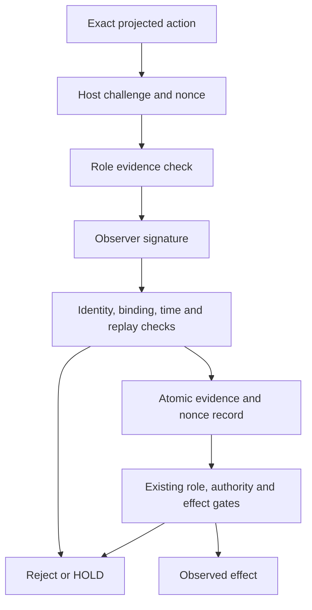

# Signed observer boundary

The center timeline already requires evidence from the reality, continuity and
projection roles. A role label alone does not identify its author. This extension
adds an optional, persisted authentication profile: the trusted host pins a
distinct Ed25519 public key for each configured observer before seeds, tickets
or actions exist. The authority database stores public keys and signed evidence;
it never stores observer private keys.

A valid signature establishes authorship under the configured key. It does not
establish truth, independent ownership, action authority or sandbox containment.

## The guarded transition



The challenge identifies the observer/key/role, root and epoch, exact action and
projection, current center and predecessor, installed profiles, and a bounded
validity window. A signed response includes the exact request, verdict, evidence
digest and observation/expiry times. Canonical JSON bytes are signed with an
explicit protocol domain. Changing a verdict, key, role, action, predecessor or
time invalidates the binding or signature.

Nonce consumption, signed proof storage and ordinary ring evidence insertion
share one SQLite transaction. An exact response retry can return its previous
record; it cannot create a new endorsement, renew evidence or advance position.
The request history is bounded. Exhaustion holds the root instead of dropping
later evidence silently.

## Persisted enforcement

| Attempt | Required result |
|---|---|
| Correct signed replies from every required role | Eligible for the existing downstream gates |
| Unsigned call to `ObserverRingStore.attest` on a signed root | Rejected |
| Reply signed by an unconfigured or different role key | Rejected |
| Modified response or response for another challenge/action | Rejected |
| Missing, expired or UNKNOWN role | Continuation held |
| One compromised signer supplies a valid SUPPORT | Remaining required roles still need their own evidence |
| Authentic fresh VETO after earlier SUPPORT | Existing permanent VETO and descendant hold apply |
| Trusted host revokes a configured key | Root held durably, including callback stages |
| Authority is reopened without an authentication wrapper | Persisted signed mode still applies |

Once installed, the signed profile cannot be replaced or disabled through these
APIs. The gate rechecks signed proof integrity and revocation inside the existing
admission and stage transactions. Key replacement requires a new governed
session/profile; this version has no automatic trust rotation.

Fresh contradictions remain admissible after a projection's original deadline.
They require a new valid host challenge and signature, and never authorize work.
An already accepted receiver record retains the existing commitment semantics:
it may finish after VETO, revocation or STOP. Its observed outcome is history,
not permission for another action.

## Separate observer processes

The host runner starts a fixed Python worker module without a shell. Each child
receives its own private key through stdin and a bounded public evidence packet.
Keys are absent from command arguments, environment, result JSON and artifacts.
The observer receives no authority-database path or other observer's key.
Input/output, duration and process cleanup are bounded; an unavailable worker
does not manufacture an endorsement.

The example role verifiers inspect three different packet shapes: an observed
state claim, a linked history, and a bounded exact projection. These are
deterministic fixture checks. The host prepares their evidence in this example.
Different PIDs and keys prove process and signing-identity separation only.

For deployment, separate observer principals need independently controlled
credentials and evidence sources, plus OS/container permissions that prevent
agents and other observers from reading their keys or writing the authority DB.
Children running under the same UID do not provide that isolation. If every
trusted role lies, signatures authenticate the lies; this protocol alone cannot
discover the collusion.

## Reproduce without models or external effects

```bash
python3 -m venv /tmp/liminal-observers-venv
/tmp/liminal-observers-venv/bin/python -m pip install \
  -r experiments/agent_control/observer-requirements.txt
PYTHONDONTWRITEBYTECODE=1 PYTHONPATH=sdk \
  /tmp/liminal-observers-venv/bin/python -m unittest \
  tests/test_agent_control_observer_auth.py \
  tests/test_agent_control_observer_process.py \
  tests/test_agent_control_observer_auth_gate.py -v
PYTHONDONTWRITEBYTECODE=1 PYTHONPATH=sdk \
  /tmp/liminal-observers-venv/bin/python -m liminal_agent_control.observer_auth_demo \
  --output artifacts/signed-observers/report.json
```

The report records executed cases, actual receiver effect counts, child process
identities, explicit scope, source commit/tree and hashes of the Python inputs.
It omits all private keys. CI uses the pinned optional dependency and uploads its
resolved dependency versions with the report. Existing unsigned roots do not
need the signing library; a signed root without it fails closed.

The bounded suite contains 71 tests: 32 authentication, 18 subprocess, and
21 effect-boundary integration tests. The demo has 15 checks across one accepted
three-process action and ten rejected scenarios. Each rejected scenario checks
zero receiver effects. Revocation between the owned DNS callback and the next
transport stage is exercised separately in the integration suite. Positive-case
public enrollment, challenges and all three envelopes are exported so the
signatures can be checked without private keys.

## Source map and limits

- LiminalOSAI parent tree `c04836a2f97a11d962b9b8c475703cebf5444b99`:
  existing center, ring, authority, nonce and receiver commitment boundaries.
- ATMAN-LATTICE `961de80e8b90a533891b9deaa6a72286302846df`,
  `model/trust_root.py` and `docs/v0.8-authority-signers.md`: pinned signer
  identities, exact role/scope/time binding, and use-time verification. This is
  a design reference; no runtime dependency or conformance claim is added.
- [Cryptography 50.0.2 Ed25519 documentation](https://cryptography.io/en/50.0.2/hazmat/primitives/asymmetric/ed25519/):
  raw key serialization, signing and verification through the maintained library.

The trusted host, authority DB, clock, pinned worker code and credential
provisioning remain trust boundaries. Hashes/signatures cannot protect against
hostile replacement of the entire trusted database and configuration. This work
does not establish universal deception detection, model alignment or prevention
of every sandbox escape.
