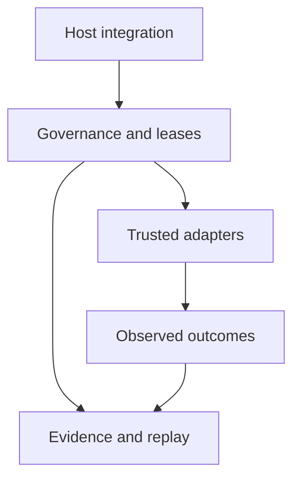

# Architecture review and refactoring

Baseline: `59579e73eea8fff9a859d5dddb501d232fbbb98b` (main after PR #219).
This review covers the repository's two implemented tracks. The owned-agent
draft stack in PRs #216–218 is outside this checkout and this refactor.

The central design remains explicit authority, a separate host effect boundary,
and independently checkable evidence. The changes below make those boundaries
hold when data is mutated, writers race, subprocesses fail, and histories grow.

## Responsibilities and dependency direction

| Boundary | Modules | Responsibility |
|---|---|---|
| C11 entry and orchestration | `core/runtime`, `pulse_kernel.c`, `liminal_substrate.c` | Validate CLI input, sequence the simulation, own subsystem lifetimes |
| C11 subsystems | `core`, `include`, conceptual layer directories | Compute bounded state transitions; retain reusable buffers in their owning context |
| Contracts and evidence | `sdk/liminal_*_contracts`, TRCP, identity, portable receipts | Normalize input, bind exact bytes and verify evidence; retain each versioned serialization profile |
| Governance state | Capability, multi-agent, epoch, objective, causal and durable brokers | Admit authority, consume budgets/leases, preserve revocation, fences and unresolved outcomes |
| Trusted effects | `adapters/` | Own filesystem/process authority, execute admitted operations and observe terminal state |
| Integration and validation | Host/GitHub SDKs, `tools`, `scripts`, `tests`, workflows | Connect explicit host operations, replay evidence and exercise declared profiles |



The C11 runtime is a separate research track, not an enforcement layer beneath
the Python brokers. Governance layers retain their own receipt schemas and
authority semantics. Shared mechanisms now include Docker session lifecycle,
strict numeric CLI validation and a complete local/CI validation entry point.
They do not introduce a generic authority engine.

## Findings and changes

| Finding at the baseline | Cause | Refactor and verification |
|---|---|---|
| A returned capability receipt could widen a live grant | Nested scope lists were shared | Detach scope on receipt creation and export; mutation cannot change subsequent authorization or stored receipt hashes |
| An effect could receive a scope changed after lease issuance | A frozen dataclass retained a mutable scope | Snapshot the normalized operation before provider callbacks and detach executor input; unchanged receipts remain byte-compatible |
| Multi-agent IDs could reset exhausted or revoked grants | Admission overwrote existing entries; check/store was unsynchronized | Reject reused IDs, serialize per-object state transitions and validate detached scopes, types and the complete validity window |
| Concurrent approval writes could silently lose a deny | Read–validate–replace had no mutation lock | Hold an exclusive file lock across creation/append; contention is explicit and an accepted denial remains present |
| Wheel audit and extracted content could differ | The archive path was reopened after approval | Audit and extract one bounded immutable byte snapshot; a changed second read cannot introduce an extra inert `.pth` entry |
| Wheel timeout did not confirm container cleanup; receipt capture was unbounded | The wheel backend bypassed the stronger Docker lifecycle | Use one named-session runner for both adapters; cap workload stdout, discard stderr, remove and verify the exact session on failure |
| A file replacement could happen but be reported `FAILED` | Post-replacement verification errors shared the pre-effect path | Report `UNKNOWN` once replacement is attempted; retain consumed lease and require reconciliation |
| File lease accepted its exact expiry instant | Inconsistent `>` boundary | Use exclusive expiry (`now >= expiry` rejects) before filesystem access |
| Effect wrapper lookup grew with all prior receipts | Control code called the audit export API twice per action | Read an O(1) count/head cursor under the existing fence; retain full export and independent verification |
| Projection duplicate checking was quadratic | Membership tested an ordered list | Add a set for membership while preserving the ordered list, replay and digest bytes |
| TRCP repeatedly serialized an already validated snapshot | Field validation and snapshot creation were coupled | Share field validation and retain one bounded JSON snapshot; remove a second whole-bundle deepcopy after ownership is established |
| QEL committed one flush per revised row | Leaf serialization also flushed | Flush once at the public revision-commit boundary, with identical rows, order and repeated-commit semantics |
| VSE allocated graph/scratch storage every cycle | Capacity and active graph size were coupled | Retain context-owned graph/scratch capacity; preserve seeded choices and arithmetic order |
| Two graph instances could lose array bounds and access memory outside allocation | A singleton registry remembered only the most recently initialized graph | Store capacity per graph, bound every traversal and add an explicit destroy lifecycle; exercise two graphs and allocation failure under sanitizers |
| Substrate accepted numeric suffixes and negative unsigned values rejected by pulse | Two entry paths enforced different validation | Share strict numeric guards, keeping profile-specific options and valid clamping behavior |
| Standard tests covered 23 of 53 Python modules | Manually enumerated test list drifted | Discover tests automatically; fail on zero tests, skips, load errors or failures; expose `make validate` |
| A forbidden first match or scanner error could pass CI | Negated `grep` commands bypassed shell `errexit` | A shared scanner succeeds only on grep's clean status; preserve patterns and fail on match/error |
| Header changes could leave stale objects | Build rules depended only on source files | Generate/include compiler dependencies and reuse C test binaries incrementally |

## Compatibility decisions

- Successful authorization, evidence and receipt schemas retain their existing
  digest bytes for the compared fixtures. No blanket canonical-JSON migration
  was made: existing packages have distinct Unicode encoding profiles.
- Atomic file receipts now use `UNKNOWN` after an uncertain replacement attempt.
  Consumers must reconcile that outcome; `after_sha256` remains the desired
  digest rather than proof that it was observed. See the
  [file mutation contract](ATOMIC_FILE_MUTATION_BROKER.md).
- Multi-agent malformed inputs, duplicate IDs and pre-issuance authorization
  are rejected. Budgets remain per grant; sibling budgets are not pooled.
- `commit_cursor()` supplements receipt export. It does not cache governance
  decisions or skip causal, epoch, objective, durable or checkpoint verification.
- QEL flush batching preserves visibility when a public call returns, not
  intermediate per-row visibility during that call. Flush is not durable fsync.
- `RGraph` adds per-instance capacity fields and `rgraph_destroy()`. Rebuild C
  consumers for the changed struct ABI; destroy initialized storage before
  reinitialization. Hand-built graphs must supply valid capacity metadata.
- VSE retains its largest successful allocation until finalization. This trades
  retained capacity for fewer allocations; it does not make the global runtime
  reentrant. Compiler/flag changes still require a clean rebuild.

## Reproduce validation and measurements

The baseline build and smoke checks passed; automatic discovery ran **927
Python tests**, with no skips. This is the starting result, not a claim that
those tests detected the defects above.

```bash
make validate
make verify-core
python3 tools/benchmark_workload_snapshot.py
```

`make validate` builds both binaries, runs their smoke checks, C tests and all
discovered Python tests, even when a local `PYTHON_TESTS` override is set.
The full suite needs Python 3 and OpenSSL in addition to a C11 compiler and Make.
The allocation/flush probes use GNU-compatible linker wrapping on Linux.
Specialized Docker/evidence workflows retain their separate assertions.

Run the same benchmark script with `--repo /path/to/baseline` and
`--repo /path/to/candidate`. It emits source identity, environment, individual
timing samples, deterministic copy counts and artifact hashes. The synthetic
workload has 300 rows by default and makes no network or model calls.

Deterministic work reductions observed in bounded probes:

| Operation | Before | After | Preserved evidence |
|---|---:|---:|---|
| JSON snapshots per normalized TRCP validation | 3 | 1 | Workload, evidence and bundle hashes |
| Archive source reads per wheel materialization | 2 | 1 | Audit document and output manifest digest |
| Duplicate comparisons for 1,200 distinct projection receipts | 719,400 | 0 equality comparisons; 2,400 set hash operations | Ordered state and journal/snapshot bytes |
| QEL flushes per 4,096-row revision commit | 4,096 | 1 | Exact raw/revision JSONL bytes and influence |
| VSE allocations/frees over 128 warm cycles | 512 / 512 | 0 / 0 | 176 choices and trace rows for each of three seeds |
| Effect-wrapper history export during one lookup | Two full exports | Zero full exports | Count/head behavior, receipt linkage and failure reservations |

These are operation counts for stated fixtures, not whole-system throughput
claims. The final strict GCC run (`make verify-core`) passed both binaries, eight C
test executables and **998 Python tests**, with no skips. The regression count
increased by 71 from the baseline. All 44 workflow YAML files parsed and the
27 scanner invocations retained their original patterns and operands.

The same complete validation also passed under GCC AddressSanitizer and
UndefinedBehaviorSanitizer. Local LeakSanitizer was disabled because this
environment cannot perform its process inspection; allocation-wrapper tests
check cleanup for the changed C buffers. The CI sanitizer profile retains
`detect_leaks=1`. Clang and real Docker validation require the remote CI jobs.

Local TRCP timings (Python 3.12.14, Linux x86-64, median of 21 samples with
10 iterations each, 300 synthetic rows) were:

| Operation | Baseline | Candidate | Reduction |
|---|---:|---:|---:|
| Validate workload snapshot | 2.0576 ms | 0.9625 ms | 53.2% |
| Build workload evidence | 2.6761 ms | 1.4967 ms | 44.1% |
| Complete external-workload fixture | 13.2567 ms | 10.7183 ms | 19.1% |

All three artifact hashes matched. [Raw samples and source fingerprints](benchmarks/architecture-refactor.json) preserve the measurement inputs. QEL retained 4,096 raw and 8,192 revision rows across two
commits; VSE matched seeds 42, 1234 and 98765 including graph growth/shrink.

## Review coverage and remaining work

The baseline inventory contained 382 tracked files, 53 Python test modules,
five C test programs and 44 workflows. Parallel reviews covered C11 runtime and
CLI paths, governance state and effect layers, integration/evidence SDKs,
trusted adapters and CI/test coverage. Entry points and direct execution in
tools were scanned; not every tool received an exhaustive semantic audit.

The next architectural work should continue at explicit boundaries:

1. Decompose the two large C orchestrators by CLI parsing, cycle state and trace
   output, using behavior captures before moving each responsibility. This
   change extracts shared input validation and hot-path storage first.
2. Audit other local ledgers for concurrency/durability guarantees. The approval
   lock is cooperative and fail-closed; a process crash can leave a stale lock.
   It is not a distributed lock or protection against a privileged host writer.
3. Evaluate import dependencies through public SDK facades only when measured
   startup cost warrants it. Keep domain exceptions and wire formats stable.
4. Extend Docker crash/restart and delayed-daemon-creation evidence. Local fake
   CLI tests verify adapter sequencing and bounded capture, not daemon/kernel
   containment. Trusted daemon diagnostic capture remains unchanged.

The host, kernel, daemon, clock, images, trust stores and authorized writers
remain declared trust inputs. File replacement is not a kernel compare-and-swap
against a hostile concurrent writer. This review does not establish production
readiness, universal escape resistance or correctness of the separate draft
agent stack.
