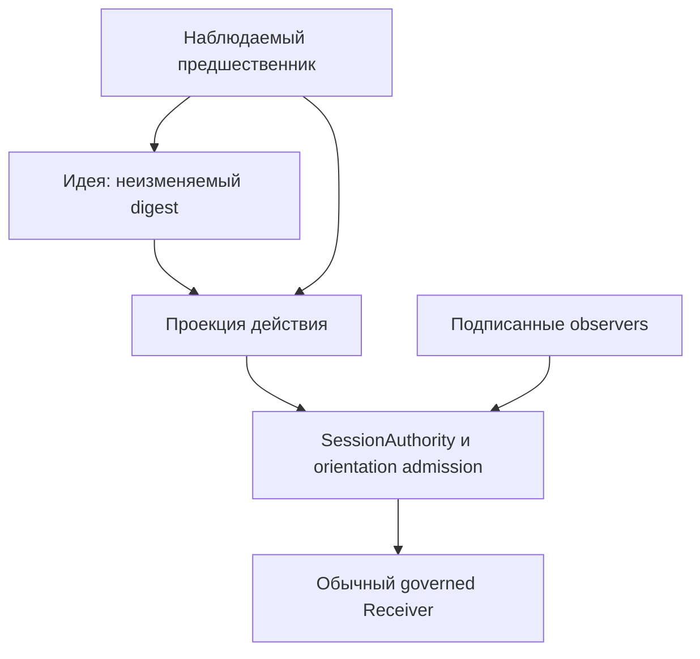
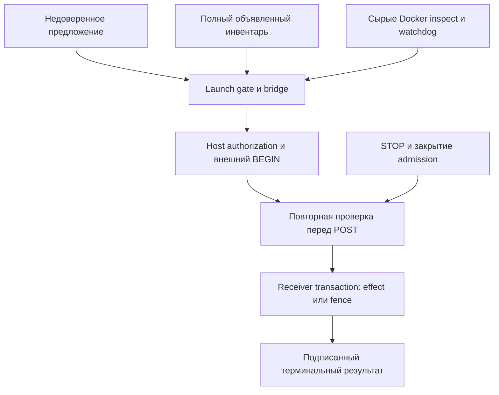
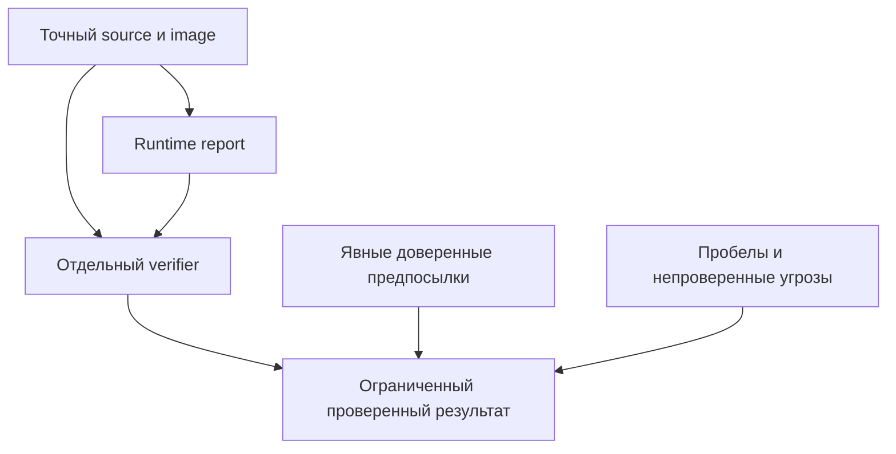

# Сеть проверок: идеи, проект, реальность и время

Эта сеть связывает ограниченное утверждение о G03 с существующим кодом,
проверками, наблюдениями и явными допущениями. Машиночитаемый источник —
[`containment_assurance_graph.v1.json`](containment_assurance_graph.v1.json).
Проверяющая программа — [`validate_containment_graph.py`](../tools/validate_containment_graph.py).

**Это проверяемая модель, а не новый механизм выдачи разрешений или доказательство
невозможности любого побега.** Результат всегда содержит
`execution_authorized: false`, `containment_status: NOT_ESTABLISHED` и
`readiness: HOLD`. `model_status: PASS` означает только согласованность модели,
проверенных ссылок на код и перечисленных ограничений. Он не разрешает запуск,
изменение политики, слияние PR или внешний эффект.

## Четыре пространства

| Пространство | Что существует | Проверка перехода | Что нельзя считать доказательством |
| --- | --- | --- | --- |
| Идеи | Цель, предложение, неизменяемый digest идеи | Связь с наблюдаемым предшественником; идея остаётся данными | Уверенность модели, план, память или текст reviewer как разрешение |
| Проект | Проекция, границы, инвентарь каналов, source, тесты | Привязка к action/revision, реальные реализации и обязательные барьеры каждого объявленного пути | Зелёный граф, пустая проверка, прежний CI или только имя компонента |
| Реальность | Контейнер, сырые Docker observations, подписанные receipts, receiver-owned SQLite effect | Реальный ограниченный runtime и независимая проверка доказательств | Заявление worker, offline inspect projection, одна лишь форма JSON |
| Время | Epoch, BEGIN, свежесть, отзыв, STOP, порядок commit/fence, reconciliation | Проверка на границе действия; неизменяемая история и сохранение UNKNOWN | Прошлое разрешение как новое; истечение BEGIN как обещание отменить уже consumed permit |

### Идея и проект: данные не становятся разрешением



Здесь показан существующий обычный governed-контур:
`CenterContinuityStore.record_idea/project`, `OrientationStore`,
`SessionAuthority` и observer hooks. `project()` не выдаёт permit; cached
guidance не заменяет транзакционную admission-проверку.

**Связь этого контура с конкретным G03 `external_agent_*` сейчас
`NOT_CONNECTED`.** Имена узлов и стрелка на рисунке не устанавливают runtime hook.
Этот пробел обязателен в v1-модели; удаление записи или замена на `CONNECTED`
отвергаются checker. Для действующей интеграции требуется отдельное изменение
реального enforcement и его негативные runtime-тесты.

### Проект и реальность: обязательные зависимости G03



Это модель контрольных зависимостей фиксированного пути, а не точный стек
вызовов и не автоматически извлечённая полная топология ОС. Машинный граф
проверяет, что **каждый объявленный путь** от `proposal` к `synthetic_effect`
проходит `launch`, `bridge`, `authorization`, `begin`, `dispatch_recheck` и
`receiver_fence` в указанном порядке. Прямая или альтернативная обходная связь,
в том числе только одного барьера, делает модель недействительной.

Пятнадцать каналов привязаны к настоящему `build_channel_inventory()` и
`verify_agent_channels()`. `DENIED`, `READ_ONLY`, `RESTRICTED`, `CONFINED`,
`MEDIATED`, `OBSERVATION_ONLY` и `TRUSTED_CONTROL` сохраняют разные значения.
Наличие записи о канале не доказывает, что все возможные каналы хоста обнаружены.
`TRUSTED_CONTROL` не означает, что соответствующие credentials доступны агенту.

### Время: что происходит после BEGIN

```mermaid
stateDiagram-v2
    [*] --> Pending: BEGIN consumes reservation
    Pending --> Committed: receiver commit proof
    Pending --> NoEffect: signed receiver fence proof
    Pending --> Unknown: response or observation lost
    Unknown --> Committed: authenticated query
    Unknown --> NoEffect: authenticated query
    Unknown --> Unknown: proof still unavailable
    Committed --> Committed: cached receipt or query
    NoEffect --> NoEffect: cached receipt or query
```



Это ограниченная модель уже начатого receiver effect. Она не заменяет все
состояния gateway. Аутентифицированный pre-permit `CONSUMED/DENIED` без receipt
также сохраняет reservation; он не становится receiver `NO_EFFECT`.

- Expiry проверяется при **BEGIN admission**. Уже consumed delayed permit может
  завершить commit после expiry, если receiver STOP ещё не выиграл транзакцию.
- Если effect выиграл до fence, `COMMITTED` остаётся `COMMITTED` после STOP.
- Если receiver fence выиграл первым, receiver выдаёт связанный с ним подписанный
  `NO_EFFECT`; локальная блокировка сама по себе этого не доказывает.
- Связь `STOP → receiver_fence` имеет тип `requests_fence`: запрос fence может
  завершиться неуспешно. Только проверяемый ответ receiver подтверждает fence;
  намерение остановиться не превращает неизвестный исход в ноль эффектов.
- Потеря ответа означает `UNKNOWN`, а не ноль эффектов. Reconciliation использует
  query и проверяемое proof; повторный POST и возврат consumed budget запрещены.
- Изменение source делает прежний report историческим. Новый snapshot, другой
  контейнер или перемена часов не обновляют доказательство автоматически.

### Доказательство и независимая проверка



Ни `report`, ни `verifier`, ни `B` не имеют ребра выдачи authority. Producer и
verifier имеют разные source bindings. Самоподтверждение и циклы поддержки
отвергаются. Разные имена файлов сами по себе не доказывают независимость oracle;
свойства существующего standalone verifier требуют отдельного review.

## Исполняемые проверки модели

```bash
python tools/validate_containment_graph.py
python -m unittest discover -s tests -p test_containment_assurance_graph.py -v
```

Checker проверяет строгую v1-структуру, четыре пространства, типы связей,
реальные file SHA-256 и AST symbols, идентичность обязательных барьеров,
невозможность обхода в объявленной модели, отсутствие циклов flow/support,
полный объявленный набор каналов, независимые роли доказательства, temporal
контракт, обязательные предпосылки и сохранение известных пробелов.

Тест канонического графа входит в обычное полное Python discovery обязательного
`make validate`. Дрейф привязанного кода и повреждение модели делают этот тест
неуспешным. Это контроль проекта; он не устанавливает отсутствующий runtime hook.

Ниже — проверка **существующего реального** G03 report. Здесь нельзя подставлять
synthetic unit fixture вместо Docker evidence:

```bash
python tools/validate_containment_graph.py \
  --report /absolute/path/to/receiver-report.json --require-current-report
```

Report обязан описывать точный HEAD/tree чистого checkout, в котором выполняется
команда. Затем повторно вызывается существующий независимый
`scripts/verify_external_agent_receiver_evidence.py`; совпадения metadata или
слова `PASS` недостаточно. Подготовительный и финальный report из merge CI нужно
проверять на их фактическом merge checkout, не переименовывая его SHA в head.

Без report результат `runtime_evidence: NOT_RUN`; требование
`--require-current-report` завершается неуспешно. Старый source даёт `STALE`, а
поддельный или неполный report не становится PASS. Даже настоящий актуальный
report подтверждает только ограниченную G03-матрицу; он не меняет
`containment_status: NOT_ESTABLISHED` и не выдаёт authority.

Поле `scope.basis_commit` в manifest — историческая отправная точка инвентаризации,
а не разрешение принимать её CI за доказательство новой версии. Source bindings
проверяют перечисленные implementation bytes, не все файлы репозитория и не
семантическую корректность кода. Изменение контролирующего source требует
пересмотра bindings и повторных runtime-проверок.

## Что остаётся открытым

| Пробел | Текущий статус | Минимальное доказательство для пересмотра |
| --- | --- | --- |
| Orientation/idea/observer hooks на конкретном G03 пути | `NOT_CONNECTED` | Реальный deny-only hook в нужной транзакционной границе; тесты без hook, с подменой lineage, stale revision и STOP |
| Kernel/Docker escape resistance | `NOT_ESTABLISHED` | Отдельная модель угроз и независимая проверка самой isolation boundary |
| Скомпрометированный host/daemon/operator | `NOT_ESTABLISHED` | Иная архитектура границ доверия и воспроизводимые доказательства для неё |
| Адаптивный live LLM | `NOT_RUN` | Ограниченный preregistered прогон настоящей модели без опасных действий и реальных секретов |
| Необъявленные каналы | `NOT_ESTABLISHED` | Независимый полный инвентарь и проверка возможностей реального окружения |
| Повтор другим оператором | `NOT_ESTABLISHED` | Независимое воспроизведение с точными source/image/artifact pins |

Trusted host, operator keys, authority stores, Docker daemon, host clock и полнота
объявленных маршрутов — **предпосылки**, не результаты испытаний. Удаление
предпосылки из JSON не делает систему защищённой от соответствующей угрозы.

Следующий обоснованный переход — закрывать конкретный пробел отдельным изменением
и доказательствами, сохраняя прежние эффекты, UNKNOWN и consumed reservations.
Число зелёных узлов, EEW outreach score и процент пройденных фиксированных кейсов
не являются процентом вероятности невозможного побега.
