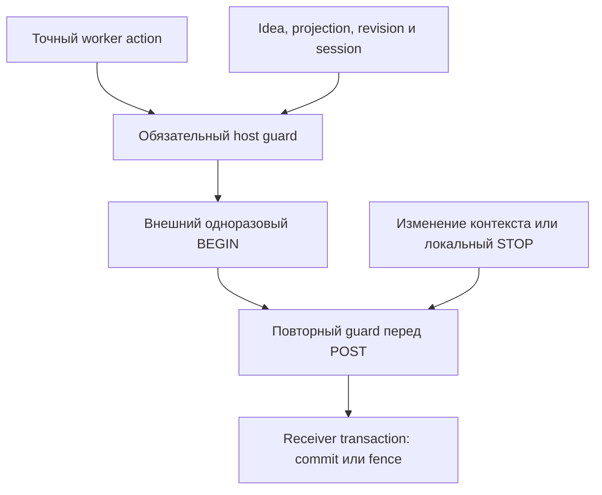

# G03: обязательный локальный veto по idea/orientation

`OrientationFencedEffectGateway` — отдельный строгий профиль существующего
receiver-fenced G03 gateway. Он требует `OrientationAdmissionGuard` при создании;
отсутствие guard не выбирает прежнее поведение. Штатный
`ReceiverFencedEffectGateway` и его фиксированная Docker-матрица остаются отдельным
профилем. Их прежние результаты не доказывают запуск нового профиля в Docker.

## Что подключено

Вместо нового языка разрешений используются существующие host-owned записи:

- `SessionAuthority`: root, execution, epoch, policy, lease и постоянные budgets;
- `OrientationStore`: профиль, наблюдаемое состояние, точная ревизия и action ticket;
- `CenterContinuityStore`: неизменяемая идея, predecessor, проекция точного action
  и ограниченное окно времени.

Guard явно требует установленные orientation **и** center profiles. У старых
общих helpers отсутствие профиля совместимо с прежними маршрутами; в строгом
профиле это не считается успешной проверкой. Политика и lineage sidecar authority
должны совпадать с effect-веткой неизменяемого G03 run binding.

Идея, проекция, hash, граф и ответ модели сами не выдают разрешение. Host заранее
готовит ticket и projection через существующие API. Guard не придумывает идею,
не подготавливает предложение за worker и не превращает зелёный граф в authority.

Первый проход использует настоящие постоянные `egress` admission и stage
reservation `g03-endpoint-post`. Повторные проверки читают тот же pending
transition, а не расходуют новый nonce/stage. После fault hooks и записи
dispatch evidence выполняется последняя локальная проверка перед endpoint POST.

В persisted gateway configuration записан обязательный orientation contract.
Прежний gateway без него не может открыть ту же DB как совместимую. Живые
объекты и методы guard привязаны отдельно от публичных configuration bytes;
замена или удаление guard закрывает admission. Это не защита от произвольного
исполнения Python внутри скомпрометированного trusted host.

## Консервативные исходы

| Момент отказа | Сохраняемый исход |
| --- | --- |
| Нет guard при создании | Конструктор отказывает до создания gateway DB |
| Нет idea/projection/ticket, неверная ревизия или закрытая session до BEGIN | Endpoint POST не вызывается; внешний permit не запрашивается |
| Локальная admission уже израсходована, последующая проверка или внешний BEGIN отказали | Локальная reservation не возвращается автоматически |
| Внешний BEGIN уже выдал permit, затем guard отказал | Сохраняется consumed reservation; gateway возвращает UNKNOWN без выдуманного receipt, NO_EFFECT или refund |
| Потерян ответ endpoint | Прежний query-only reconciliation; повторный POST не разрешается |
| Guard/его DB недоступны после выдачи permit | Новое исполнение запрещено; безопасные query и проверка старых signed receipts остаются доступны |

Это свойство уже созданного gateway instance. Холодное создание или повторное
открытие строгого gateway требует здорового типизированного guard; восстановления
нового instance без sidecar этот профиль не обещает.

Этот шаг **не** добавляет автоматическую обратную связь signed receipt →
orientation observation. Локальная transition остаётся pending до отдельного
достоверного наблюдения через существующие trusted-host API. Нельзя освободить её
по ответу worker, callback PASS, предполагаемому нулю эффектов или возврату budget.
Новый независимый переход потребует такого наблюдения либо нового host-owned run;
молчаливой переинициализации старого состояния нет.

## Граница времени и STOP

Guard не держит SQLite writer lock во время HTTP или Docker операций. Поэтому
локальный STOP, выигравший **до** последней проверки, блокирует POST. Если STOP
произошёл уже после неё, он не отменяет задним числом remote commit. Единственная
линеаризация receiver STOP и effect остаётся прежней receiver-owned SQLite
транзакцией. Для остановки run используется существующий coordinator STOP,
включая внешний authority и receiver fence, а не только sidecar session STOP.

Expiry внешнего permit по-прежнему проверяется при BEGIN. Deadline center
projection — дополнительный локальный veto; он не продлевает и не переписывает
внешний permit. `COMMITTED` остаётся неизменяемым, UNKNOWN не становится NO_EFFECT,
а подписанный NO_EFFECT может выдать только соответствующий receiver.

## Что доказывают проверки

Негативные интеграционные проверки используют настоящие подписанные loopback
HTTP-запросы, authority/receiver/sidecar SQLite и явные supervisor/bridge doubles.
Они проверяют реальный путь admission и dispatch, но не измеряют Docker containment.
Полная прежняя G03-матрица отдельно проверяет 14 контейнеров / 15 каналов /
8 requests / 6 synthetic effects / 2 signed NO_EFFECT на своём профиле.

v1 assurance graph продолжает описывать штатный маршрут. Его
`g03_orientation: NOT_CONNECTED` не повышается в CONNECTED из-за существования
отдельного строгого профиля. Default rollout, новая Docker-матрица этого профиля,
автоматическая независимая observation feedback, kernel escape resistance,
необъявленные каналы и compromised-host resistance здесь не установлены.
Глобальные `containment_status: NOT_ESTABLISHED`, `readiness: HOLD` и
`execution_authorized: false` сохраняются.
