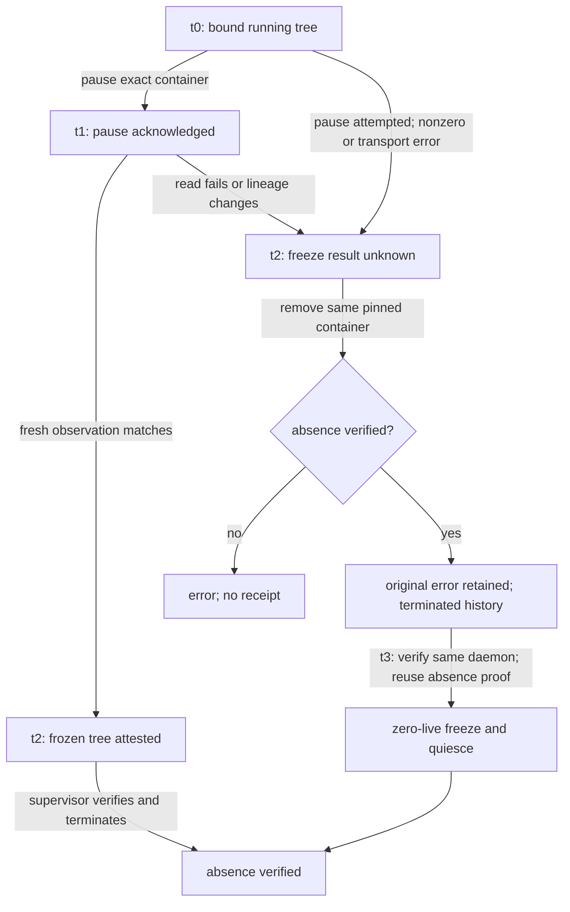

# Isolated Execution Broker — container-enforced process MVP

## Purpose

This layer turns the v1.3 reference mediation decision for `process.execute` into one concrete container-backed execution path.

```text
process.execute request
→ exact RuntimeOperation
→ exact IsolatedExecutionPlan digest
→ Runtime Mediator / Capability Broker
→ trusted Docker adapter
→ hardened container
→ digest-only execution observation
→ Runtime Mediation receipt
→ Isolated Execution receipt
→ causal trajectory
```

## Enforced container profile

The trusted Docker adapter launches a validated immutable image ID with:

- an explicitly cleared image ENTRYPOINT, so the exact plan argv is executed;
- `--log-driver none`, preventing workload log retention by the daemon;
- `--network none`
- `--read-only`
- `--cap-drop ALL`
- `--security-opt no-new-privileges:true`
- non-root `65534:65534`
- PID limit `64`
- memory limit `256m`
- CPU limit `1.0`
- bounded `/tmp` tmpfs with `nosuid,nodev,noexec`
- `/workspace` mounted read-only

The SDK requires an immutable Docker image ID in `sha256:<64 hex>` form. Mutable tags are rejected.

## Authority split

`liminal_isolated_execution` is model-facing governance code. It imports no subprocess/socket/filesystem mutation API and cannot invoke Docker directly.

`adapters/docker/liminal_docker_executor.py` is a **trusted host adapter**. Its shared `run_docker_plan` entry point receives a validated `IsolatedExecutionPlan`, constructs an argv list, and invokes Docker with `shell=False`. Normal execution, wheel materialization and isolation probes use this same lifecycle boundary.

Access to the Docker daemon is therefore a privileged control-plane boundary and must not be exposed directly to the governed agent.

## Exact-plan binding

The runtime operation's `payload_sha256` must equal the digest derived from the exact container plan:

```text
immutable image ID
+ argv digest
+ host workspace path-string digest
+ timeout
+ isolation profile digest
→ plan_sha256
→ payload_sha256
```

Changing the image ID, arguments, workspace **path string** or isolation profile
after authorization invalidates the execution request before backend dispatch.
The legacy field `host_workspace_sha256` hashes the canonical path string. It
does **not** hash directory contents, resolve filesystem aliases or bind an
immutable filesystem snapshot. Files or symlink targets can change without
changing this digest. This generic profile requires a trusted host writer and a
stable workspace throughout authorization and execution. A one-time `realpath`
or tree hash alone would still leave a check/use race; adversarial host writers
require a separately governed immutable staging/snapshot design.

Container operations also require `scope.images`, a nonempty allow-list of
immutable image IDs. The requested image list must be a subset of the actual
grant, and the plan image must occur in the requested list. A payload digest
cannot supply this authorization. Existing image-less container grants fail
closed and must be reissued with explicit image scope. Generic noncontainer
`process.execute` operations keep their existing scope contract.

Fixed G03 worker profiles explicitly select their trusted `python3` ENTRYPOINT;
their argv consists of interpreter arguments. Their effective ENTRYPOINT and
daemon log configuration remain independently checked. This profile-specific
configuration is never a model-controlled plan field.

## Output boundary

Normal execution discards raw stdout/stderr. The governance receipt contains only bounded safe metadata digests and the process exit result. Executor errors are reduced by Runtime Mediator to an error-type digest.

Wheel receipts and the isolation self-test capture stdout with a 64 KiB limit enforced while reading. The reader accepts at most one additional byte to detect overflow, then aborts the session. Workload stderr is discarded. The self-test does not expose a general command execution interface.

## Session lifecycle

Every run starts with a fresh host-assigned name and a recorded daemon identity. The adapter creates an inert container with `--restart no` and session/plan labels, requires an acknowledged full container ID, validates its image and ownership, and only then starts that ID. The name is used for discovery after an unacknowledged create; start, pause and removal target immutable IDs. The process-tree backend also pins the daemon and container ID when attaching.

A client exit does not establish workload completion. Success requires an observed `exited` state with the same exit code, followed by removal and confirmed absence of that ID on the same daemon. A same-name replacement is not removed. Control-plane stdout/stderr are bounded, including inspection and cleanup; workload stderr is discarded. Each control operation has a finite timeout. Cleanup has its own bounds beyond the plan's create/start deadline.

Timeout, client death, malformed control responses, daemon outage and cleanup failure retain the trusted session identity in `DockerExecutionError.session`. An unacknowledged create remains `UNKNOWN` even after a current absence observation or removal of a late-created inert container: the original pending request cannot be proven cancelled. Recovery through `reconcile_docker_session` never starts a container.

`DockerExecutor` and the wheel executor accept an optional trusted `session_observer`. It receives an immutable `DockerSessionIdentity` before create and again after ID acknowledgement, before start. A recorder failure before create prevents dispatch; a failure after create triggers cleanup and an `UNKNOWN` result. For a single trusted writer, an operator can append each `identity.as_document()` to a private pre-created journal and flush/fsync it before returning:

```python
def record_session(identity):
    with journal_path.open("a", encoding="utf-8") as journal:
        journal.write(json.dumps(identity.as_document(), sort_keys=True) + "\n")
        journal.flush()
        os.fsync(journal.fileno())

executor = DockerExecutor(session_observer=record_session)
```

The caller owns journal permissions, durable storage, restart recovery and retention. Without that recorder, an abrupt Python process/host crash can lose the in-memory identity and bypass cleanup. The fixture below kills a Docker client and restarts a dedicated daemon; it does not test a Python adapter process or host crash.

`ExecutionOutcomeUnknown` is preserved through Runtime Mediator and the epoch, objective, causal and durable effect wrappers. Receipts report `UNKNOWN` and authority remains consumed. An inner unknown effect retains the durable reservation (`EFFECT_UNKNOWN_RESERVATION_STUCK`), with explicit `effect_outcome_unknown` and `reconciliation_required` reasons. A later durable evidence failure reports the observed reservation status or leaves it unconfirmed. Runtime consumers must reconcile the recorded session, effect and durable state before authorizing retries or clearing reservations. A verified container removal alone does not reconstruct a lost workload result. Successful receipt bodies and hashes keep their existing format.

For trajectory risk, an admitted `UNKNOWN` retains an `ALLOW` event representing
a possible dispatched effect, with privilege bounded by `max(before, after)`.
Its receipt and event metadata keep the `UNKNOWN` outcome. Each mediator retains
the highest unresolved bound in all later event privilege levels. This is a
conservative in-process risk bound, not an observation of actual privileges;
later outcomes and containment release cannot lower it without a separate
trusted reconciliation contract, and this patch exposes no reset API.
Trajectory analysis recommends a risk decision; containment and release remain
explicit host actions.

The shared `FencedTrajectoryRiskLedger` also retains an in-process uncertainty
flag before post-dispatch diagnostics. An unknown effect or known-success causal
evidence failure makes its authoritative decision `BLOCK`. Its separate
uncertainty gate and digest bind the actual verified head, graph and detector
receipt; `verified_trajectory_decision` preserves the detector's decision, and
no committed event is fabricated. All brokers sharing that ledger reject new
issuance and projections, and consume previously issued leases without dispatch
when they are presented. Verified fact appends and containment release do not
clear this flag. Trusted reconciliation requires a separate contract; there is
no reset API. This in-process gate complements the durable retained reservation.

After a validated effect succeeds, failure of its trajectory append or final
causal receipt raises `CausalEffectEvidenceError`, preserving the known result
digest and compatibility with `CausalEffectCommitError` handlers. When the
append-failure receipt can be recorded, it retains
`EFFECT_SUCCEEDED_EVIDENCE_FAILED`. Runtime mediation reports `UNKNOWN` with
`effect_succeeded` and the specific `trajectory_append_failed` or
`causal_commit_receipt_failed` reason, keeping the effect in trajectory risk.
Outer durable wrappers retain the known result digest and evidence reason in
their commit and runtime receipts, together with the consumed lease and
reservation. Missing optional diagnostic receipts do not erase the typed result.

After the inner effect succeeds, a missing/unavailable inner receipt, world
observation failure, finalization error or final durable receipt failure raises
`DurableEffectEvidenceError`. It preserves the known result digest, specific
evidence reason, reservation status and durable commit confirmation, and remains
compatible with both `DurableGovernanceError` and `ExecutionOutcomeUnknown`.
Runtime mediation keeps `UNKNOWN` and the effect in risk analysis. The shared
ledger is blocked before diagnostics. A lost finalization acknowledgement can
follow a completed store commit; a final receipt failure can follow an
acknowledged commit. These paths report a released reservation when observed,
or `durable_reservation_unconfirmed` when it cannot be established, and never
re-reserve or roll back. The shared ledger uncertainty gate remains in-process.

Across epoch, objective, causal and durable wrappers, a secondary diagnostic
cursor, state-read or receipt failure preserves an existing
`ExecutionOutcomeUnknown` marker; it cannot convert uncertainty into `FAILED`.
Known-success causal evidence failures also retain their typed marker when the
diagnostic failure receipt is unavailable. Secondary causes use bounded error
codes. A cursor failure before executor dispatch retains the ordinary failure
contract, and genuine executor failures remain excluded from effect rules.

`tests/test_docker_adapter_lifecycle.py` uses local Python subprocesses as a fake Docker CLI. It checks ownership, bounded output, late creation, client death, same-name replacement and uncertainty propagation, but does not establish Docker/kernel containment. `tests/fixtures/isolated_executor/docker_failure_probe.py` adds six CI scenarios with a real, separately owned daemon: normal completion, lost create response, delayed create delivery, Docker client death, delayed start against a removed ID with a same-name sentinel, and daemon stop/restart. Delays and response loss are explicitly injected at the trusted CLI transport boundary. The fixture only stops its own daemon, loads the locally built immutable image ID, and emits facts checked by an independent verifier; the report is bounded diagnostic evidence, not an attestation against a malicious host.

The [isolation workflow](../.github/workflows/isolated-execution-broker.yml) runs these scenarios and uploads `docker-failure-lifecycle` evidence bound to the tested checkout and image ID. All six owned-daemon scenarios, their standalone fact verifier, isolation probes and governed execution passed in [CI run 38538316272](https://github.com/safal207/LiminalOSAI/actions/runs/38538316272), associated with PR head `5aa119b03eed5189726dceb7b01bdf96ba488a94`. Pull-request CI tests its recorded merge checkout; this source identity is retained in the artifact. Local fake-CLI tests are not a substitute for that run. Earlier probes remain recorded in [CI run 38481395912](https://github.com/safal207/LiminalOSAI/actions/runs/38481395912) for revision `5f4843a975244e4844c6b0c0f77c6b6e1a82635d`.

## Runtime configuration probes

The isolation CI workflow builds a minimal fixture image and checks that the container reports:

1. UID `65534` rather than root;
2. `NoNewPrivs: 1`;
3. `CapEff: 0000000000000000`;
4. the root mount marked read-only;
5. the `/workspace` mount marked read-only;
6. only the loopback network interface under `network=none`.

These are observations of runtime configuration, not live outbound-network or filesystem-write attempts.

The separate `docker_behavior_probe.py` campaign exercises actual bounded
behavior, with an intentionally weakened control for each of six checks:
inherited ENTRYPOINT, daemon logging, root-filesystem writes, workspace writes,
TCP to a disposable internal-network listener, and active seccomp filtering.
The independent verifier checks raw argv, immutable image lineage, container
inspection, attached output, exit state and cleanup. The `none` logging case
also requires attached stdout to remain readable. Weakened argv mutations are
diagnostic controls in this disposable campaign. The production builder exposes
no model-controlled weakening options; trusted adapter authority remains part
of the security boundary.
This does not establish PID/memory exhaustion resistance, the exact seccomp
policy, arbitrary outbound-network isolation, or kernel exploit resistance.

The direct process-tree adapter rereads the actual tree after pause and rejects
running nodes or changed lineage. The public containment supervisor retains its
own independent post-action snapshot and comparison. A successful pause followed
by an unreadable or changed tree is an incomplete freeze, even though the
container may already be paused. The adapter attempts verified removal of the
same immutable container on the pinned daemon and still raises the original
freeze failure. Failed removal leaves recovery unresolved; that attempt cannot
produce a containment receipt. No recovery path unpauses the workload.

A nonzero pause result or a transport exception during that attempted action
uses the same verified-removal recovery. Neither result establishes whether the
container became paused. If pause is persistently rejected, recovery must not
depend on a later successful pause before attempting removal. Failure before
the action, such as an unavailable initial snapshot, still raises without
assuming that an action was dispatched.

A later retry can attest an already-frozen tree without issuing a duplicate
pause. After verified removal, a fresh daemon-identity check can reuse the prior
verified absence of that immutable container to attest all previously observed
processes as terminated. This terminal path does not repeat container inspection;
it allows the supervisor to complete its normal freeze/quiesce protocol with
zero live processes. A missing child in
one live process-table read is not by itself proof of termination. Cleanup does
not refund authority, erase the earlier failure, or prove that no effect occurred.

### Causal graph across state, evidence and time

| Space | Bound state | Required link |
| --- | --- | --- |
| Intent | Contain one authorized execution session | Session, daemon and immutable container identity |
| Project | Adapter action and supervisor receipt | Actual observation hashes and unchanged lineage checks |
| Runtime | Running, paused or absent container | Fresh live observations; terminal history requires verified removal and a current daemon binding |
| Time | Before action, after action, recovery, retry | Each conclusion uses observations from that transition |



The graph separates physical state from what the observer can establish. An
unavailable Docker daemon cannot be interpreted as an absent container; likewise
a failed log query cannot establish disabled log retention, and a missing network
endpoint cannot establish membership in the owned control network. These are
evidence failures at distinct edges, not interchangeable passing checks. A valid
receipt establishes the bounded observed transition, not future immunity to
container-runtime or kernel vulnerabilities.

## Explicit nonclaims

This is concrete container-runtime enforcement for `process.execute`, but it is **not** a VM boundary and does not prove resistance to Docker/container-runtime/kernel vulnerabilities.

Separate [wheel materialization](OFFLINE_WHEEL_MATERIALIZER.md), [credential injection](BOUND_CREDENTIAL_BROKER.md) and [atomic file replacement](ATOMIC_FILE_MUTATION_BROKER.md) profiles describe their own trusted adapters and limits.

Repository branch protection remains separately blocked by #134.
